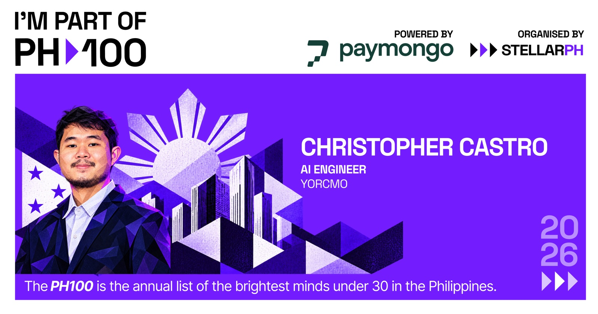

 &nbsp;  &nbsp;  &nbsp; 

## About

I am an AI engineer and full-stack developer based in Cebu, Philippines. I build LLM-powered automations and the applications around them: agents that carry out real work, retrieval systems that answer from an organization's own data, and interfaces that keep people in the loop.

I hold a BS in Computer Science (Artificial Intelligence track) from Cebu Institute of Technology, graduating *cum laude*, and serve as Chief Technology Officer of Google Developer Group Cebu.

&nbsp;

## Recognition

- **PH100 2026 Honoree**: named to the annual list of the brightest minds under 30 in the Philippines, organised by StellarPH and powered by PayMongo.
- **Top 6 National Finalist, PNHRS 2025**: RetinAI, a mobile deep-learning approach to diabetic retinopathy detection.
- **1st Place, Best Research Paper, CVHRIC 2025**: the same RetinAI research, at the Central Visayas Health Research and Innovation Conference.
- **Best Overall Open Source Contributor**: Cebu Hacktoberfest 2024.

&nbsp;

## Selected public projects

| Project | Description |
| --- | --- |
| [**ai_health_coach**](https://github.com/ChristopherCastro69/ai_health_coach) | Full-stack AI health coach application, containerised with Docker. |
| [**Loan-Checker-AI**](https://github.com/ChristopherCastro69/Loan-Checker-AI) | Loan-eligibility classifier with 85% accuracy. [Live demo](https://loan-checker-ai.streamlit.app/) |
| [**HeartAlert**](https://github.com/ChristopherCastro69/HeartAlert) | Heart-failure risk prediction model. [Live demo](https://heartpredictiongpt.streamlit.app/) |
| [**Webscraping_Selenium**](https://github.com/ChristopherCastro69/Webscraping_Selenium) | Automated job-listing extraction for data analysis. |
| [**UnShelf**](https://github.com/ChristopherCastro69/UnShelf) | Food-saver e-commerce Android application (Kotlin, Firebase). |

&nbsp;

## Toolbox

&nbsp;

## Activity

